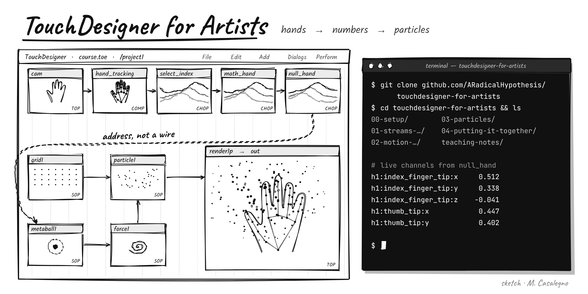

# TouchDesigner for Artists

An open, four-session introduction to [TouchDesigner](https://derivative.ca) for artists and designers with no programming background. By the end you have built a working interactive system: a webcam watching you, MediaPipe finding your hands in the image, thousands of particles responding to where you point, and a finished image on screen.

Each session is one hands-on workshop of about an hour. Slides, starting files and homework are included for every session, together with the teaching notes that explain the places where beginners get stuck.

Created by [Mattia Casalegno](https://www.mattiacasalegno.net).

**Course history.** Developed and first taught in Summer 2026 as the workshop strand of *Digital Media & Interaction: Installations* (four weekly workshops, August–September 2026). Published here as an open resource in October 2026. The [v1.0 release](../../releases/tag/v1.0) holds the materials as taught.

## What you build

| Session | Title | You leave with |
|---|---|---|
| 0 | [Pre-flight setup](00-setup/) | TouchDesigner, a free licence and the MediaPipe plugin installed and tested *before* the first class |
| 1 | [Streams and conversion](01-streams-and-conversion/) | A live webcam effect built from six nodes, including a feedback loop |
| 2 | [Motion becomes number](02-motion-becomes-number/) | Your fingertip as three live numbers, and a line drawn between thumb and index finger |
| 3 | [Particles](03-particles/) | Ten thousand points pushed around by an invisible force you steer with the mouse |
| 4 | [Putting it together](04-putting-it-together/) | Hand-controlled, instanced particles with trails, composited over the camera, running fullscreen |

The course runs on one file that grows week by week. Nothing is thrown away between sessions.

## Three ideas the whole course is built on

1. **Streams and conversion.** TouchDesigner is streams of data and boxes that convert between them: pictures into numbers, numbers into movement, movement back into a picture. Nothing runs top to bottom; data flows through whatever you have wired, sixty times a second.
2. **Address, not a wire.** Some connections are not cables. They are a node's path typed or dragged into a parameter field, and a wrong address fails without any error. See [teaching-notes/address-not-a-wire.md](teaching-notes/address-not-a-wire.md).
3. **Named Nulls at section boundaries.** A Null is a labelled outlet on the wall. Everything downstream reads `null_look` or `null_hand`, so you can rebuild what is behind it without breaking anything. This is why swapping the mouse for your hand in Session 4 is a single change.

And one method that solves most problems: **click through the chain node by node and read what each one actually outputs.** The place where it stops making sense is the place to fix. The full list of silent failures is in [teaching-notes/silent-failures.md](teaching-notes/silent-failures.md).

## Requirements

- **TouchDesigner 2025.33070.** The course files were made in this build; a different build may refuse to open them. The free Non-Commercial licence is enough (it caps output at 1280×1280, which is why the course works at 1280×720).
- **The MediaPipe TouchDesigner plugin** by Torin Blankensmith, from [its releases page](https://github.com/torinmb/mediapipe-touchdesigner/releases/latest). Download `release.zip`, not "Source code".
- A webcam (a built-in laptop camera is fine), about 3 GB of free disk space, and a machine that can run TouchDesigner: Windows 10/11 64-bit with a dedicated GPU preferred, or an Apple Silicon Mac.

[Session 0](00-setup/) walks through installation step by step and ends with a checklist.

## Using the files

The `.tox` files are TouchDesigner components. To use one, drag it from your file browser into a TouchDesigner network, or use **File → Import** inside a network.

- `session*.tox` are the starting or checkpoint networks for each session. If your own file breaks, import the checkpoint and carry on with everyone else.
- `homework*.tox` are reference solutions for the short homework exercises.
- Sessions 2 and 4 need the MediaPipe plugin running in the same project. The plugin itself (`MediaPipe.tox`, over 500 MB) is not included here; get it from the plugin release as described in Session 0.

The slide decks are included as PDFs in each session folder.

## For instructors

The pacing, the pre-flight routine, the homework-by-screen-recording workflow and the reasoning behind the order of topics are in [teaching-notes/for-instructors.md](teaching-notes/for-instructors.md). The notes on MediaPipe's hand data (channel names, mirroring, why `h1` is not "left") are in [teaching-notes/mediapipe-hand-data.md](teaching-notes/mediapipe-hand-data.md).

You are welcome to teach with these materials. Please credit the source (see licence below).

## Where to go next

The course deliberately skips Python, GLSL shaders, audio reactivity, POPs (the newer GPU particle family), building your own components, and sending signals out over OSC, DMX or NDI. Each of them is a variation on things you will already have done: nodes, wires, addresses, and reading what each step actually outputs.

## Credits

- [TouchDesigner](https://derivative.ca) is made by Derivative.
- [MediaPipe TouchDesigner](https://github.com/torinmb/mediapipe-touchdesigner) is an MIT-licensed plugin by Torin Blankensmith, built on Google's [MediaPipe](https://ai.google.dev/edge/mediapipe/solutions/guide).
- Some patches were developed and checked against a live TouchDesigner session through [touchdesigner-mcp](https://github.com/8beeeaaat/touchdesigner-mcp), a third-party open-source MCP server by 8beeeaaat. It is not part of this course and is not needed to follow it.

## Licence

- TouchDesigner components (`.tox` files): [MIT](LICENSE).
- Lesson text, slides and teaching notes: [Creative Commons Attribution 4.0 (CC BY 4.0)](LICENSE-CONTENT.md).

Suggested credit: *"TouchDesigner for Artists" by Mattia Casalegno, CC BY 4.0, github.com/ARadicalHypothesis/touchdesigner-for-artists*
